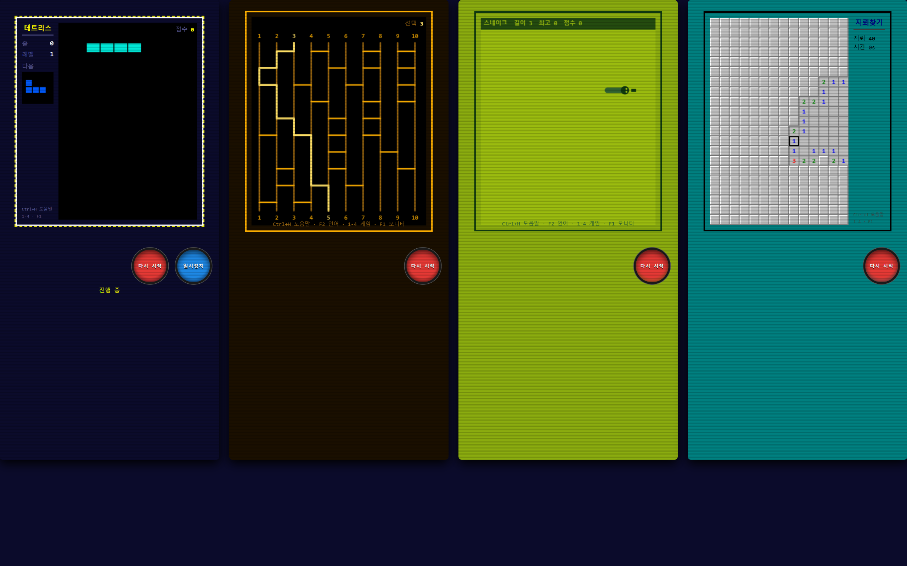

# Tetris for Orca

[**English**](README.md) | 한국어

Orca 사이드바에서 하는 레트로 게임 모음입니다. 테트리스, 사다리, 스네이크, 지뢰찾기가 들어 있습니다. 규칙은 herdr-tetris 를 따릅니다.

F1을 누르면 새로운 세상이 열립니다.



## 기능

- 게임 4종. 숫자 키 1~4 로 고릅니다. 진행 중인 판은 다른 게임으로 갔다 와도 남아 있습니다.
- 테트리스: 7-bag 순서, 다음 블록 미리보기, 회전과 벽 킥, 하드 드롭, 레벨, 점수
- 사다리(아미다쿠지), 스네이크, 지뢰찾기
- 처음 보이는 모니터 화면(F1). 가짜 대시보드입니다.
- 도움말 팝업(Ctrl+H): 게임마다 조작법을 보여 줍니다.
- 언어 7종: 한국어, 영어, 일본어, 독일어, 스페인어, 프랑스어, 러시아어. 브라우저 언어를 따르고, F2 로 바꿉니다.

## 조작

| 키 | 동작 |
| --- | --- |
| 1~4 | 게임 전환 (1 테트리스, 2 사다리, 3 스네이크, 4 지뢰찾기) |
| F1 | 모니터 화면과 게임 화면 전환 |
| F2 | 언어 바꾸기 |
| Ctrl+H | 도움말 열기와 닫기 |
| R | 지금 게임 다시 시작 |
| P | 일시정지 / 계속 (테트리스) |

테트리스: ← / → 이동, ↑ 회전, ↓ 내리기, Space 바로 떨어뜨리기.
스네이크와 지뢰찾기: 방향키 또는 WASD. 지뢰찾기는 Space / Enter 로 칸을 열고 F 로 깃발을 꽂습니다.
사다리: ← / → 로 시작 열을 고릅니다.

키를 누르기 전에 패널을 한 번 클릭해서 포커스를 주세요.

## 요구 사항

- Orca 1.4.246 이상. 별도 프로그램은 필요 없습니다.

## 개발

```text
node --test tests/game.test.ts tests/games.test.ts
orca plugin dev load .
```

규칙, 구조, 개발, 상태, 할 일은 [docs/](docs/README.md)를 보세요.

## 알려진 제한

- Orca 안에서 키 입력과 화면 배치는 아직 확인하지 않았습니다. 개발 폴더 캡처는 초기 버전만 찍었습니다.
- 일부 호스트 단축키가 패널보다 먼저 키를 받을 수 있습니다(테스트 중 Ctrl+T 는 터미널을 열었습니다).
- 번역은 원어민 검토를 받지 않았습니다.
- 모니터의 CPU, 메모리 값은 표시하지 않습니다. 모니터는 가짜 대시보드입니다.

## 라이선스

MIT. [LICENSE](LICENSE) 를 보세요.
