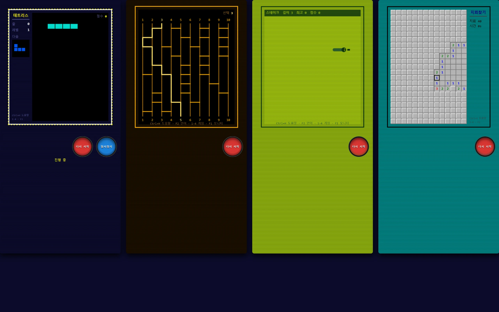

# Tetris for Orca

English | [**한국어**](README.ko.md)

Retro games in the Orca sidebar: Tetris, Ladder, Snake, and Minesweeper. Rules follow herdr-tetris.

Press F1 and a new world opens.



## Features

- Four games, switched with the number keys 1–4. An unfinished game is kept when you switch away.
- Tetris: 7-bag order, next-piece preview, rotation with wall kicks, hard drop, level, score.
- Ladder (Amidakuji path finder), Snake, and Minesweeper.
- A monitor screen (F1) that you see first. It is a fake dashboard.
- Help popup (Ctrl+H) that explains each game's controls.
- A coin slot under the buttons: click it to see a coin drop in.
- Tetris waits for your first key before the blocks start falling.
- Seven languages: Korean, English, Japanese, German, Spanish, French, Russian. The language follows your browser; press F2 to change it.

## Controls

| Key | Action |
| --- | --- |
| 1–4 | Switch game (1 Tetris, 2 Ladder, 3 Snake, 4 Minesweeper) |
| F1 | Switch between monitor and game |
| F2 | Change language |
| Ctrl+H | Show or hide the help popup |
| R | Restart the current game |
| P | Pause / resume (Tetris) |

Tetris: ← / → move, ↑ rotate, ↓ soft drop, Space hard drop.
Snake and Minesweeper: arrow keys or WASD. Minesweeper also uses Space / Enter to open a cell and F to flag it.
Ladder: ← / → choose a start column.

Click the panel once to focus it before using the keys.

## Requirements

- Orca 1.4.246 or later. No extra programs are needed.

## Development

```text
node --test tests/game.test.ts tests/games.test.ts tests/i18n.test.ts
orca plugin dev load .
```

See [docs/](docs/README.md) for rules, structure, development, status, and todo.

## Known limitations

- Keys and screens were checked inside Orca, except F2 (language), which has not been pressed in Orca yet. The coin animation was checked in a browser only.
- Some host shortcuts may catch keys before the panel (Ctrl+T opened a terminal during testing).
- Translations were written without native review.
- Herdr-tetris's monitor system stats (CPU, memory) are not shown. The monitor is a fake dashboard.

## License

MIT. See [LICENSE](LICENSE).

## Support the project

If this project is useful to you, consider buying the developer a coffee.

[](https://ko-fi.com/dev_ohyt)
